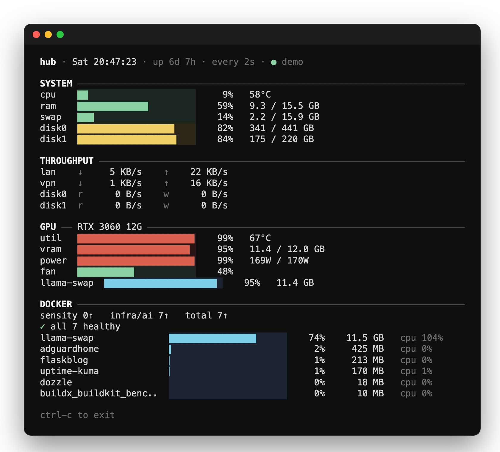

# mtop

[](https://github.com/michaljach/mtop/releases/latest)
[](https://github.com/michaljach/homebrew-tap)
[](go.mod)
[](LICENSE)

**mtop** is a fast terminal system monitor (TUI) for homelab servers and Macs. One screen shows CPU, RAM, swap, disks, network and disk throughput, NVIDIA or Apple Silicon GPU, and Docker containers, refreshing every couple of seconds. Think `htop` or `btop` trimmed down to what matters on a home server, with GPU and Docker built in.



## Features

- **System**: CPU usage and temperature, RAM, swap, and usage for each mounted disk
- **Throughput**: LAN and VPN (`tun`, `wg`, `tailscale`, `utun`…) rates, plus read/write rates for each disk
- **GPU**
  - NVIDIA via `nvidia-smi`: utilisation, temperature, VRAM, power, fan, and per-process VRAM
  - Apple Silicon: utilisation, GPU memory, and CPU/GPU temperatures read from the SMC (no root needed)
- **Docker**: running counts per compose project, health checks, and memory/CPU per container

Sections whose data isn't available (no GPU, no Docker) are hidden. Bars are green below 75%, yellow from 75% and red from 90%. Per-process and per-container bars are blue.

## Install

### Homebrew (macOS and Linux)

```sh
brew install michaljach/tap/mtop
```

### Prebuilt binaries

Download the binary for your platform from the [latest release](https://github.com/michaljach/mtop/releases/latest):

```sh
# Linux x86_64. For other platforms, use mtop-linux-arm64, mtop-darwin-arm64 or mtop-darwin-amd64.
curl -L -o mtop https://github.com/michaljach/mtop/releases/latest/download/mtop-linux-amd64
chmod +x mtop
sudo mv mtop /usr/local/bin/
```

macOS marks downloaded binaries as quarantined. If Gatekeeper blocks it, run `xattr -d com.apple.quarantine mtop`.

### With Go

```sh
go install github.com/michaljach/mtop/cmd/mtop@latest
```

### From source

```sh
git clone https://github.com/michaljach/mtop.git
cd mtop
go build -o mtop ./cmd/mtop
```

## Usage

```sh
mtop                 # live dashboard; q or ctrl-c to exit
mtop -interval 5s    # refresh every 5 seconds (default 2s)
mtop -once           # print a single frame and exit
mtop -demo           # sample data, handy for checking the layout
mtop -version
```

## Requirements

- **Linux or macOS.** On macOS the temperature readings need a build with cgo, which is the default when building on a Mac and is how the release binaries are built.
- **`nvidia-smi`** on `PATH` for NVIDIA GPU stats.
- **`docker`** on `PATH`, with your user allowed to talk to the daemon (for example via the `docker` group), for container stats.

## License

[MIT](LICENSE) © Michal Jach
